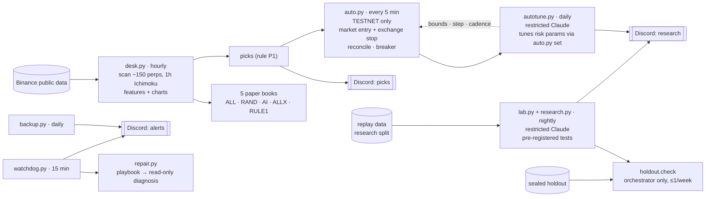

# Signal Desk

A self-operating crypto-signal research and execution system. It runs unattended on a 2 GB cloud VM, and AI agents do the day-to-day operations, research and risk tuning inside hard, code-enforced limits.

> **Status:** research project, paper trading plus the Binance futures **testnet** only. Nothing here trades real money, and nothing here claims to be profitable. Its main finding so far is negative: taking every signal of the underlying Ichimoku scanner has a negative expected value after costs.

[中文說明在下方](#中文說明)

## What it does

| Loop | Cadence | Who decides | Hard limits in code |
|---|---|---|---|
| Scan, paper books, picks | hourly | fixed rules (`PROTOCOL.md`, `PICKS.md`) | rule changes only at pre-registered checkpoints |
| Testnet execution | every 5 min | fixed rules | demo URL only, exchange-side stop on every position, breaker |
| Risk tuning | daily | restricted Claude agent | bounds, 0.67–1.5× steps, de-risk ≤1/day, other changes need ≥7 days and ≥30 trades |
| Research | nightly | restricted Claude agent | ≤6 tests/night, Bonferroni over all tests, sealed holdout ≤1/week |
| Ops | 15 min / daily | deterministic playbook, then read-only AI | whitelisted units, once per issue per 6h, ≤6/day |

## Engineering highlights

- **AI agents with least privilege.**
  - Every headless `claude -p` run gets an explicit tool allowlist and denylist: one editable file, specific CLI subcommands, no network, no secrets.
  - The agent never edits a risk parameter directly. It calls `auto.py set`, which enforces bounds, step size and cadence: de-risking is allowed any time, while other changes need at least 7 days and 30 closed trades since the last one.
  - Facts in every report are generated from the database, never taken from the agent's own text.
- **Research hygiene built in.**
  - Hypotheses must be written down in the notebook before they are tested.
  - Bonferroni correction runs over every test ever run.
  - Confidence intervals come from a day-clustered bootstrap.
  - A daily budget caps the number of tests.
  - The sealed holdout can't be read by the agent and is checked at most once a week.
  - Known data leaks are written into the notebook.
- **Execution safety (testnet).**
  - The base URL is hard-coded to the demo exchange.
  - Every position gets an exchange-side stop. A missing stop is re-placed automatically, and if a stop can't be placed the position is closed.
  - Entry intents are written before orders are sent, so an order with an unknown outcome is reconciled on the next run instead of being retried blindly.
  - Other parties' symbols and positions are never touched.
  - A daily-loss breaker halts new entries.
- **Self-healing operations.**
  - The watchdog checks timers, logs, disk, memory and backup age, repeats alerts and sends recovery notices.
  - The repair playbook acts at most once per issue per 6h and at most 6 times a day, then hands off to a read-only diagnosis.
- **Honest evaluation.**
  - Paper books include a random-pick control (RAND) and a take-everything baseline (ALL).
  - The "what-if" replays mark open trades to market, avoiding the survivor bias that otherwise showed a 0% win rate.

## Layout

| Path | What |
|---|---|
| `desk/` | hourly scanner wrapper, paper books, pick rule, manual-trade sync (`PROTOCOL.md`, `PICKS.md` are the pre-registered rules) |
| `auto/` | testnet auto-executor, policy, what-if replays |
| `lab/` | research CLI (`lab.py`), one-time split (`prepare.py`), sealed-holdout checker (`holdout.py`) |
| `ops/` | watchdog, self-repair, backup, nightly research and daily tuning orchestrators, agent prompts |
| `news/` | crypto / tech news digests and a daily tool recommender (RSS + Claude summaries → Discord) |
| `systemd/` | all units and timers |
| `config/` | example config files (real ones live outside the repo) |
| `docs/` | architecture, research method, safety model |

Not included:
- `SignalScanner.py`, the signal generator that `desk.py` imports.
- All data: sqlite databases, replay pickles, charts.
- All secrets.

## Running it

1. Python 3.12 with `pandas`, `numpy` and `matplotlib`, plus the Claude Code CLI for the agent parts.
2. Copy `config/*.example*` to `~/.config/desk/` and `desk/phone.json`, then fill in your own values.
3. Install the units from `systemd/` and enable the timers you want.

Every agent run is optional: the trading and ops code runs without Claude.

## Results so far (honest summary)

- **Every signal, after 0.10% cost per side** (2021–25 replay, 29k signals): about −8 to −25 bp per trade, with a win rate of about 32%.
- **Exits:** the Ichimoku kijun exit is the worst. Opposite-signal and stop-plus-time exits do better, but are still about zero or negative.
- **Low-ATR subset ("RULE1"):** about +18 bp/trade in development, but the day-clustered CI includes 0, the median trade is about −200 bp, and profit is concentrated in the top 5% of trades. Not significant.
- **Nightly lab:** on its first night it rejected the "near kijun is better" hypothesis outright, and found only a weak, non-significant US-session effect.

The value of the project is the machinery for rejecting ideas cheaply and safely, not a strategy.

---

## 中文說明

Signal Desk 是一套在 2GB 雲端主機上**無人值守**運作的加密貨幣訊號研究與執行系統。日常維運、研究和風控調整由 AI agent 負責，但它們的權限和可調範圍都被**寫死在程式裡**。

- **每小時：** 掃描約 150 個永續合約的 1 小時一目均衡表訊號。
  - 同時記錄 5 本紙上帳本，其中有隨機挑選的對照組。
  - 依預先登記的規則挑出推薦，附圖表發到 Discord。
- **每 5 分鐘：** 在 Binance **測試網**自動執行推薦。每筆都有交易所端停損，另外有單日熔斷和對帳機制。
- **每天：** 受限的 Claude 檢討交易結果，只能在規定的範圍和頻率內調整風控參數。
- **每晚：** 受限的 Claude 做預先登記的假設檢定，並套用多重檢定校正。封存資料只由排程程式驗證，每週最多一次。
- **維運：** 每 15 分鐘監控一次，出問題時先跑固定修復程序，再做唯讀的 AI 診斷。每天備份並異地保存。

**目前結論：** 全部照做的訊號扣成本後期望值為負。這個專案的價值在於**便宜又安全地否定想法**的流程，而不是一個能賺錢的策略。本專案不構成投資建議。
